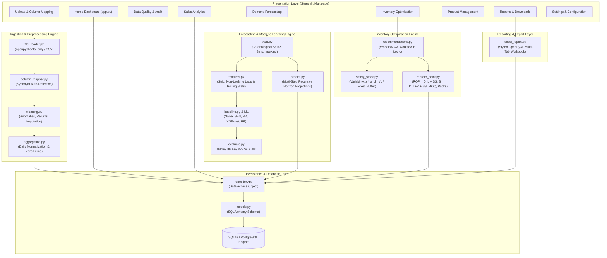
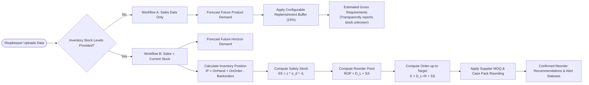
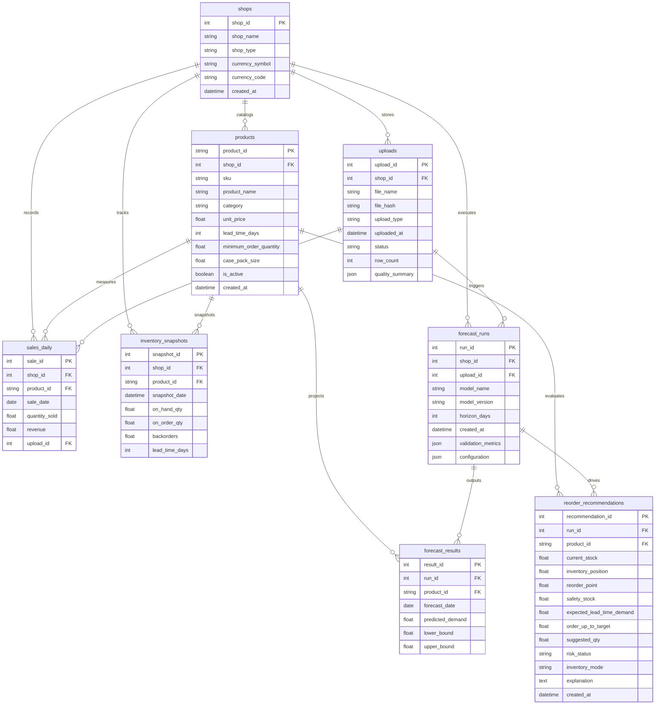

# System Architecture & Technical Design

## Retail Sales Forecasting & Inventory Optimization System

### 1. Architectural Overview

The system is designed following a **layered, decoupled service-oriented architecture (SOA)**. It cleanly isolates user interface presentation (Streamlit), data ingestion, validation, machine learning forecasting, inventory optimization algorithms, and relational data persistence (SQLAlchemy / SQLite).

---

### 2. Dual Inventory Workflow Architecture

The application implements two distinct inventory replenishment workflows to handle shops with different levels of technical record-keeping:

---

### 3. Database Entity Relationship (ER) Model

---

### 4. Machine Learning & Forecasting Pipeline Details

1. **Chronological Splitting (No Data Leakage):**
   - The time series is never randomly shuffled.
   - For an observation series of $N$ days, the most recent $V = \min(14, \max(3, \text{int}(0.2 \times N)))$ days are reserved exclusively for out-of-sample holdout validation.
   - Training features are derived strictly from observations prior to the validation window.

2. **Causal Feature Engineering:**
   - **Lags:** $y_{t-1}, y_{t-7}, y_{t-14}, y_{t-28}$.
   - **Rolling Statistics:** Shifted by 1 so that period $t$'s actual sales cannot leak into features:
     $\text{rolling\_mean\_7}(t) = \frac{1}{7} \sum_{i=1}^7 y_{t-i}$.
   - **Calendar Determinants:** Day of week ($0\dots 6$), Weekend indicator ($0/1$), Day of month ($1\dots 31$), Month of year ($1\dots 12$), ISO week of year ($1\dots 53$).

3. **Multi-Step Recursive Prediction:**
   - To project $H$ periods into the future ($7, 15, 30$ days), predictions are generated step-by-step.
   - Step $t+1$ is predicted, appended to the sequence, and lags/rolling features are recalculated dynamically for step $t+2$ through $t+H$.
   - Negative model predictions are floored at $0.0$ units.
   - Prediction intervals are computed using the validation holdout residual standard deviation:
     $$\hat{y} \pm 1.645 \times \sigma_{\text{residual}}$$

---

### 5. Inventory Optimization & Periodic Review Formulation

The inventory engine evaluates a **$(R, s, S)$ Periodic Review Policy**:

1. **Inventory Position ($IP$):**
   $$IP = \text{On-Hand Stock} + \text{On-Order Units} - \text{Backorders}$$

2. **Expected Lead Time Demand ($D_L$):**
   $$D_L = \sum_{t=1}^{L} \hat{y}_t$$

3. **Safety Stock ($SS$):**
   - **Variability Method:**
     $$SS = \lceil z \times \sigma_d \times \sqrt{L} \rceil$$
     Where $z$ is the standard normal deviate for the target cycle service level (e.g., $z = 1.645$ for 95%), $\sigma_d$ is the standard deviation of daily demand, and $L$ is supplier lead time in days.
   - **Buffer Fallback Method (used when historical demand is sparse):**
     $$SS = \lceil \text{Buffer\%} \times \bar{d} \times L \rceil$$

4. **Reorder Point ($ROP$):**
   $$ROP = D_L + SS$$

5. **Order-up-to Target ($S$):**
   $$S = D_{L + R} + SS$$
   Where $R$ is the store review cycle period (e.g., 7 days).

6. **Preliminary Order Quantity ($O_{\text{prelim}}$):**
   $$O_{\text{prelim}} = \begin{cases} \max(0, S - IP) & \text{if } IP \le ROP \\ 0 & \text{if } IP > ROP \end{cases}$$

7. **Packaging & Supplier Constraints:**
   - If $0 < O_{\text{prelim}} < \text{MOQ}$, order is rounded up to $\text{MOQ}$.
   - If $\text{Case Pack Size} > 1$, order is rounded up to the nearest multiple:
     $$O_{\text{final}} = \lceil \frac{O_{\text{prelim}}}{\text{Pack Size}} \rceil \times \text{Pack Size}$$

---

### 6. Security & Safe Data Handling

- **Formula Injection Prevention:** Excel uploads are parsed with openpyxl in `data_only=True` mode, ensuring only cached calculated cell values are ingested. Dynamic macro execution, DDE links, and script bombs are disarmed.
- **File Upload Limits:** Strict 25 MB payload threshold prevents memory exhaustion and zip-bomb attacks.
- **SQL Parameterization:** All database read/write queries are mediated through SQLAlchemy ORM parameter binding, preventing SQL injection vulnerabilities.
- **Data Isolation:** Every record in `sales_daily`, `products`, `uploads`, and `inventory_snapshots` is partitioned by `shop_id`.
